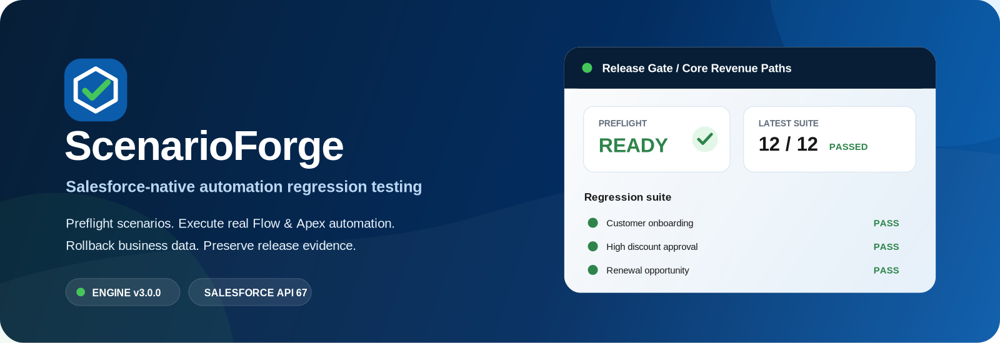

<p align="center">
  
</p>

<h1 align="center">ScenarioForge</h1>
<p align="center"><strong>Salesforce-native business-process regression testing that developers can deploy and use immediately.</strong></p>
<p align="center">Build scenarios visually, validate them before execution, run real Flow/Apex automation in isolated transactions, and keep durable regression evidence without leaving test records behind.</p>

<p align="center">
  
  
  
  
  
</p>

---

## What ScenarioForge is

Salesforce automation is rarely isolated. Updating one Flow can affect triggers, validation rules, assignment logic, related records, and downstream business behavior. Apex unit tests remain essential, but teams also need a readable regression layer that represents the actual business journey.

ScenarioForge turns those journeys into executable Salesforce-native scenarios:

```text
Scenario
   │
   ├─ Preflight metadata + CRUD/FLS validation
   │
   ▼
Savepoint
   │
   ├─ Create / Find / Update / Delete records
   │        └─ Real synchronous Flow, Trigger and Validation Rule execution
   │
   ├─ Assertions + execution telemetry
   │
   ▼
Rollback target business data
   │
   └─ Persist ScenarioForge run evidence
```

Everything runs inside a single Salesforce transaction: target business data is created, updated, deleted, and asserted for real, then always rolled back — while the execution evidence (pass/fail, expected vs. actual, timing) is kept.

### Guided Scenario Builder

You no longer need to author JSON for normal scenarios.

```text
Action → Object → Field / Value → Save
```

ScenarioForge loads accessible Salesforce objects and fields, builds the configuration document automatically, and keeps **Advanced JSON** available when you need source-level control.

### First-run onboarding

On an empty installation, the first launch opens **Setup & Quick Start** instead of an empty dashboard. The quick installer preloads a starter pack, so the first launch can go straight to a ready workspace. From there you can:

- verify target-object access;
- install a ready-to-run starter pack with one click;
- create smoke, lifecycle, and relationship scenarios;
- create a starter regression suite;
- open the first scenario immediately.

### Scenario templates

The Scenarios workspace includes reusable templates for common patterns such as:

- record smoke testing;
- full create/update/assert/delete lifecycle testing;
- parent/child relationship testing.

Templates enter the org as **Draft**, so destination-specific Preflight runs before activation.

### Regression suites

Group release-critical scenarios into a suite. ScenarioForge chains each scenario into a separate Queueable transaction, giving each scenario its own governor-limit budget and preserving suite-level evidence.

---

## How to install it

### Prerequisites

- Salesforce CLI (`sf`)
- a Developer Edition, sandbox, or scratch org
- permission to deploy metadata

### 1. Run the installer

If the org alias is not authenticated yet, the installer automatically opens Salesforce web login.

macOS / Linux:

```bash
./install.sh my-sandbox
```

Windows PowerShell:

```powershell
./install.ps1 -OrgAlias my-sandbox
```

The installer automatically:

1. verifies the authenticated org;
2. deploys ScenarioForge metadata;
3. assigns `ScenarioForge_Admin` to the current user;
4. installs the starter scenario pack.

### 2. Open Salesforce

```bash
sf org open --target-org my-sandbox
```

Then open:

```text
App Launcher → ScenarioForge
```

### Manual install

Prefer to control each step yourself?

```bash
sf org login web --alias my-sandbox
sf project deploy start --target-org my-sandbox --source-dir force-app
sf org assign permset --name ScenarioForge_Admin --target-org my-sandbox
sf apex run --target-org my-sandbox --file scripts/apex/installStarterPack.apex
```

### Redeploy / update

```bash
./deploy.sh my-sandbox ScenarioForge_Admin
```

### Verify an installation

```bash
./verify.sh my-sandbox
```

This runs the ScenarioForge Apex test suite with code coverage enabled. Windows PowerShell equivalents: `./deploy.ps1` and `./verify.ps1`.

---

## Your first scenario

1. Open **Scenarios**.
2. Choose **Templates → Account Smoke Test**, or click **New Scenario**.
3. Open the Scenario Builder.
4. Click **Add Step**.
5. Select an action, object, field, and value in the Guided Builder.
6. Click **Preflight**.
7. Resolve blocking errors if any.
8. Click **Run Scenario**.
9. Review expected/actual values and execution telemetry in the run report.

The business records created or changed by the scenario are rolled back after the run. ScenarioForge keeps the run/result evidence.

---

## Supported actions

| Action                     | Purpose                                                          |
| -------------------------- | ---------------------------------------------------------------- |
| `CREATE_RECORD`            | Create target test data and optionally register an alias.        |
| `FIND_RECORD`              | Find one existing accessible record and register it as an alias. |
| `UPDATE_RECORD`            | Update a record from an earlier alias.                           |
| `DELETE_RECORD`            | Delete an aliased record inside the isolated transaction.        |
| `ASSERT_FIELD`             | Compare a field with an expected value.                          |
| `ASSERT_RECORD_EXISTS`     | Require at least one matching record.                            |
| `ASSERT_RECORD_NOT_EXISTS` | Require zero matching records.                                   |
| `ASSERT_RECORD_COUNT`      | Compare matching-record count against an expected number.        |

Supported assertion operators include `EQUALS`, `NOT_EQUALS`, `CONTAINS`, `NOT_CONTAINS`, `STARTS_WITH`, `ENDS_WITH`, `GREATER_THAN`, `GREATER_OR_EQUAL`, `LESS_THAN`, `LESS_OR_EQUAL`, `IS_NULL`, and `NOT_NULL`.

Runtime values:

```text
${TODAY}
${NOW}
${USER_ID}
${account}      ← record alias from an earlier step
```

---

## Product workspaces

| Workspace               | What it does                                                      |
| ----------------------- | ----------------------------------------------------------------- |
| **Setup & Quick Start** | First-run readiness, starter pack installation, and onboarding.   |
| **Overview**            | Pass rate, active scenarios/suites, failures, and recent runs.    |
| **Scenarios**           | Create, template, duplicate, import, open, and execute scenarios. |
| **Scenario Builder**    | Guided authoring, Advanced JSON, aliases, Preflight, and export.  |
| **Regression Suites**   | Compose release gates and queue scenario execution.               |
| **Run History**         | Search the execution trail.                                       |
| **Execution Evidence**  | Expected/actual values, duration, CPU, SOQL, and DML telemetry.   |

---

## Security and isolation model

ScenarioForge intentionally separates target business data from product telemetry.

**Target data** uses explicit user-mode database operations. CRUD, FLS, and sharing of the running Salesforce user determine what a scenario can access.

**Execution evidence** is stored in ScenarioForge internal run/result objects after the target transaction is rolled back.

A savepoint rollback protects normal synchronous DML changes. It does **not** magically reverse every external or asynchronous side effect. Automation that sends email, performs callouts, publishes platform events, or queues asynchronous work needs deliberate test-environment controls.

## Roles

ScenarioForge ships with three permission sets:

- `ScenarioForge_Admin` — full configuration and execution access.
- `ScenarioForge_Author` — scenario/suite authoring and execution.
- `ScenarioForge_Runner` — execution-focused access with read-only scenario definitions.

These permission sets grant ScenarioForge access only. Users still need the appropriate permissions for any target Salesforce object used by a scenario.

---

## Developer setup

Repository sanity checks:

```bash
npm install
npm run audit
npm run format:check
```

Salesforce Code Analyzer:

```bash
sf plugins install code-analyzer
sf code-analyzer run --workspace force-app --severity-threshold 2
```

CI includes repository checks, formatting, Code Analyzer, and an optional authenticated-org deployment validation workflow.

---

## Repository structure

```text
ScenarioForge/
├── force-app/main/default/
│   ├── applications/
│   ├── classes/
│   ├── lwc/
│   ├── objects/
│   ├── permissionsets/
│   ├── staticresources/
│   └── tabs/
├── examples/scenarios/
├── scripts/apex/
├── manifest/package.xml
├── install.sh
├── install.ps1
├── verify.sh
├── verify.ps1
└── README.md
```

## Project status

ScenarioForge is an open-source developer tool intended for Developer Edition, sandbox, scratch-org, QA, and controlled test environments. Validate the behavior against your org's automation model before making it part of a release gate.

## License

ScenarioForge is released under the [MIT License](LICENSE).
